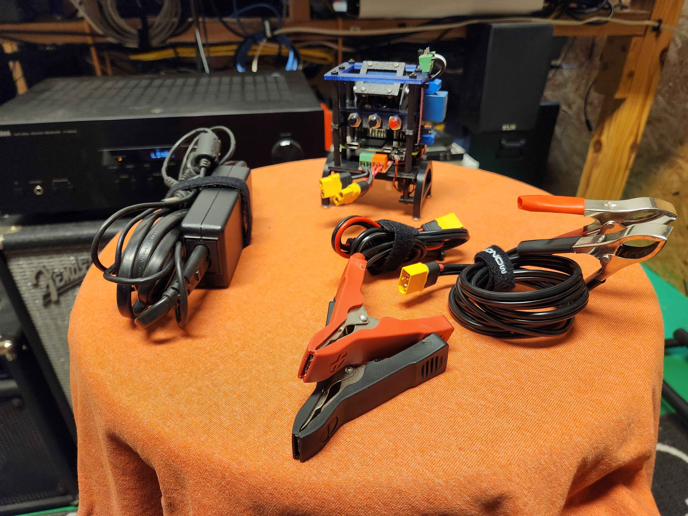

# BATMON

### A Pi &amp; Python DC Volt &amp; Current Monitor

Description and Parts list can be found [here](https://www.drgerg.com/batmon.html) at drgerg.com.

(Not for sale as a kit. Build your own.)
